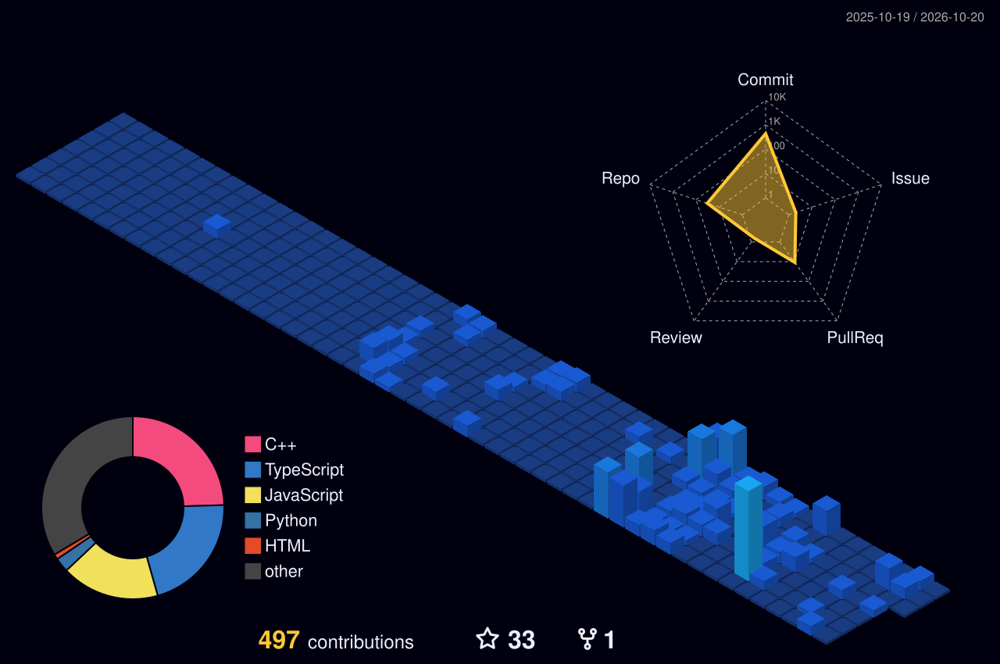

 

  

  
  &nbsp;
  
  &nbsp;
  
  &nbsp;
  

---

### 👨‍💻 About Me

I am an **AI/ML undergraduate at Narula Institute of Technology**, focused on engineering assistive technologies and intelligent web platforms that solve tangible real-world problems. My work combines **applied deep learning**, **biosignal / IoT hardware**, and **scalable full-stack architecture**.

- 🎓 **Education:** B.Tech in Artificial Intelligence & Machine Learning (Narula Institute of Technology)
- 🧠 **Research & Focus:** Wearable EMG signal processing, biomedical computer vision, and assistive human-machine interfaces
- 🔨 **Currently Building:** **BoneTalk (Saakantha)** — an AI wearable interpreting neuromuscular EMG signals to vocalize speech for speech-impaired individuals
- 💻 **Core Stack:** Python, C++, PyTorch, OpenCV, JavaScript/TypeScript, React, Node.js, Express, MongoDB
- 🚀 **Hackathons & Open Source:** Actively participating in national hackathons and building developer-centric tools

---

### ⚡ Engineering Focus & Mindset

| Domain | Focus & Direction | Primary Technologies |
| :--- | :--- | :--- |
| 🦴 **Assistive Wearables** | Neuromuscular EMG signal decoding & vocal synthesis | Python, Biosensors, Embedded IoT |
| 🏥 **Healthcare AI** | Clinical document OCR, prescription extraction, diagnostic aids | OpenCV, PyTorch, Tesseract, MERN |
| 🌐 **Modern Web & Web3** | Tamper-proof verification systems & developer productivity tools | React, Next.js, Node.js, Solidity |

---

### 🚀 Featured Projects

| Project | Description | Tech Stack | Links |
| :--- | :--- | :--- | :---: |
| **🦴 BoneTalk (Saakantha)** | AI-powered wearable assistive communication system converting throat/jaw EMG muscle signals into natural speech for mute individuals. | `Python` `Embedded AI` `IoT` `Signal Processing` | *Active Development* |
| **📜 NotaryChain** | Decentralized document notarization and validation system guaranteeing cryptographic integrity for digital certificates and contracts. | `Solidity` `Polygon` `Web3.js` `React` `Node.js` | [GitHub](https://github.com/soumik7484-art/notary-chain) (⭐ 16) |
| **🔍 ContriLens** | Open-source contribution discovery platform streamlining issue exploration and repo onboarding for new contributors. | `React` `Next.js` `Tailwind CSS` `GitHub API` | [GitHub](https://github.com/soumik7484-art/Contriblenss) • [Live Demo](https://ui-ux-for-opensource.vercel.app) |
| **🏥 MediAI Suite** | Full-stack healthcare application with handwritten prescription OCR, report analysis, and an AI diagnostic assistant. | `Python` `OpenCV` `MERN Stack` `Groq API` | [GitHub](https://github.com/soumik7484-art/final-prototype-mediai-) |
| **⛏️ Smart Mine Monitor** | Real-time IoT monitoring platform tracking hazardous gas concentrations (HCHO/CO) and worker safety in underground mines. | `JavaScript` `IoT Sensors` `WebSockets` `Vercel` | [GitHub](https://github.com/soumik7484-art/smart-mine-monitor) • [Live Demo](https://smartmine-delta.vercel.app) |

---

### 🛠️ Technical Skillset

#### 💻 Programming Languages

  

#### 🤖 AI & Machine Learning

  

#### 🌐 Web & Backend Architecture

  

#### 🗄️ Databases, Tools & Embedded Systems

  

---

### 📊 GitHub Activity & Analytics

  
  &nbsp;
  

  

---

### 📈 Contribution Visualizations

  

  

---

### 🏆 Achievements & Badges

  

---

### 🐍 Contribution Grid Snake

  <picture>
    <source media="(prefers-color-scheme: dark)" srcset="https://raw.githubusercontent.com/soumik7484-art/soumik7484-art/output/github-contribution-grid-snake-dark.svg" />
    <source media="(prefers-color-scheme: light)" srcset="https://raw.githubusercontent.com/soumik7484-art/soumik7484-art/output/github-contribution-grid-snake.svg" />
    
  </picture>

---

### 🤝 Let's Connect & Collaborate

  I am always enthusiastic about collaborating on <b>Healthcare AI</b>, <b>Assistive Technology</b>, and <b>Open-Source Projects</b>.

  
  &nbsp;
  
  &nbsp;
  

 

  

